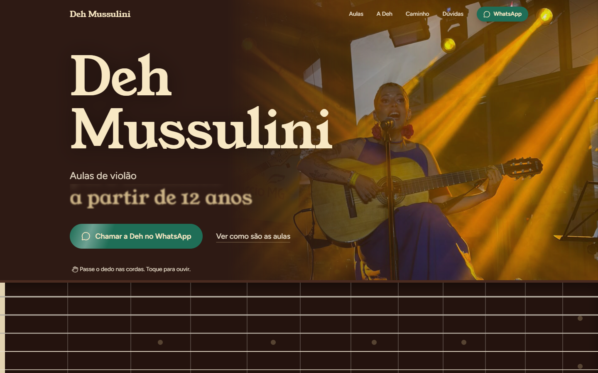

<div align="center">

# Deh Muss · Aulas de violão

**Site de divulgação das aulas de violão online da professora Deh Muss, formada em Música pela UFMG.**
Quem chega pelo link conhece as aulas e, com um toque, abre uma conversa no WhatsApp com a Deh, já com a mensagem escrita.

[](https://github.com/wellesley-mussolini/deh-mussulini/actions/workflows/site.yml)
&nbsp;
[**Abrir o site**](https://wellesley-mussolini.github.io/deh-mussulini/)



</div>

## O que o site faz

- **Leva ao WhatsApp da Deh.** Todo botão de contato abre `wa.me` em nova aba, com a mensagem pronta: *"Oi, Deh! Vi seu site e quero saber mais sobre as aulas de violão."* O visitante só aperta enviar.
- **Convida a tocar.** Na abertura, as seis cordas atravessam a tela sobre uma escala com os trastes na posição real do instrumento. Elas vibram quando o cursor ou o dedo passa por cima e, ao clicar, soam a nota da afinação padrão (Mi, Lá, Ré, Sol, Si, Mi), sintetizada no próprio navegador.
- **Apresenta as aulas como elas são:** online, para quem tem zero ou pouco conhecimento de violão, a partir de 12 anos, com ritmos brasileiros e internacionais e apostila de música brasileira cifrada.
- **Conta a história em seções:** como são as aulas, quem é a Deh, o caminho do primeiro acorde às primeiras músicas, dúvidas comuns e o convite final, com fotos reais dela no palco.
- **Funciona em qualquer tela.** O layout é pensado primeiro para o celular, com menu próprio, e se abre em colunas no desktop.
- **Respeita quem não quer movimento.** Com "reduzir movimento" ligado no sistema, as animações de deslocamento, a vibração das cordas e a faixa de estilos param. O conteúdo continua todo lá.

## Design system

A página alterna os dois materiais do violão: a **escala**, escura, e o **tampo**, claro. As cores vêm do instrumento.

| Token | Cor | De onde vem |
|---|---|---|
| `jacaranda` | `#2E1A14` | madeira da escala; fundo escuro e texto |
| `tampo` | `#F1D7A0` | abeto do tampo; fundo claro |
| `tampo-claro` | `#F8E8C4` | texto sobre fundo escuro |
| `madeira` | `#8A4B2A` | lateral do violão; brilhos de fundo |
| `roseta` | `#1F6E57` | o verde dos mosaicos da roseta; toda ação de WhatsApp |
| `corda` / `traste` | `#E7DCC8` / `#B9B2A6` | cordas de náilon e cordas revestidas, trastes |

- **Tipografia:** [Young Serif](https://fonts.google.com/specimen/Young+Serif) nos títulos e [Figtree](https://fonts.google.com/specimen/Figtree) no texto, servidas pelo próprio site (Fontsource).
- **Movimento**, todo com [Motion](https://motion.dev):
  - **Abertura:** o nome sobe letra por letra, a foto do palco entra com zoom lento e luz pulsante, as cordas são desenhadas e dedilhadas sozinhas, e a linha de destaque alterna entre os fatos das aulas (*online*, *para iniciantes*, *a partir de 12 anos*…).
  - **Cordas:** cada toque solta uma nota (♪ Lá) que sobe do ponto tocado.
  - **Seções:** títulos entram palavra por palavra; os diferenciais deslizam e os ícones giram para dentro; o selo "Formada em Música pela UFMG" gira sobre a roseta; a linha do caminho é percorrida na rolagem e acende cada etapa alcançada; a faixa de destaques corre sem parar.
  - **Ação:** os botões principais de WhatsApp recebem um brilho periódico, e o botão flutuante aparece depois da abertura.
- Os tokens ficam em [`src/index.css`](src/index.css), no bloco `@theme` do Tailwind v4, e viram classes como `bg-tampo` e `text-roseta`.

## Tecnologias

| | |
|---|---|
| Interface | React 19 + TypeScript |
| Estilo | Tailwind CSS v4 |
| Animação | Motion |
| Som | Web Audio API, sem arquivos de áudio |
| Build | Vite |
| Testes | Vitest + Testing Library |
| Publicação | GitHub Actions → GitHub Pages |

## Rodando localmente

Precisa de Node.js 24.

```bash
npm ci
npm run dev        # site em http://localhost:5173/deh-mussulini/
```

| Comando | O que faz |
|---|---|
| `npm run dev` | Servidor de desenvolvimento |
| `npm run test:run` | Testes (Vitest, uma rodada) |
| `npm run lint` | ESLint |
| `npm run build` | Checagem de tipos + build de produção em `dist/` |
| `npm run preview` | Serve o build de `dist/` |

## Editando o conteúdo

| Quero mudar | Arquivo |
|---|---|
| Número do WhatsApp, Instagram ou mensagem pronta | [`src/constants/contato.constants.ts`](src/constants/contato.constants.ts) |
| Textos das aulas, fatos em destaque, etapas e dúvidas | [`src/domains/aulas/conteudo.constants.ts`](src/domains/aulas/conteudo.constants.ts) |
| Itens do menu | [`src/constants/navegacao.constants.ts`](src/constants/navegacao.constants.ts) |
| Fotos | [`src/assets/fotos/`](src/assets/fotos) (substitua mantendo o nome do arquivo) |
| Imagem da prévia ao compartilhar o link | [`public/compartilhamento.jpg`](public/compartilhamento.jpg) (640×640) |

## Estrutura

```
src/
├── App.tsx                        # monta a casca e a página
├── constants/                     # contato da Deh (WhatsApp e Instagram) e itens do menu
├── components/                    # BotaoWhatsapp, usado em toda a página
├── integracoes/                   # whatsapp.integracao.ts: link wa.me com a mensagem pronta
├── layout/                        # cabeçalho, rodapé e botão flutuante do WhatsApp
├── utils/                         # texto.utils.ts: operações técnicas genéricas
└── domains/aulas/
    ├── PaginaAulas.tsx            # ordem das seções
    ├── secoes/                    # abertura, aulas, destaques, sobre, caminho, dúvidas, chamada final
    ├── componentes/               # escala do violão, corda que vibra, fatos em destaque, título revelado
    ├── hooks/                     # useCordasTocadas (som e notas), useFatoDaVez (alternância)
    ├── services/                  # somDoViolao.service.ts: síntese da nota da corda
    ├── conteudo.constants.ts      # todos os textos da página
    ├── violao.constants.ts        # cordas na afinação padrão e duração da nota
    ├── animacoes.constants.ts     # curvas e variantes de animação
    └── aulas.types.ts             # tipos do domínio
```

As regras de código do projeto estão em [`AGENTS.md`](AGENTS.md), incluindo o sufixo obrigatório por tipo de arquivo (constantes em `*.constants.ts`).

## Publicação

Cada pull request roda lint, testes e build. O merge na `prod` publica o site no GitHub Pages automaticamente ([`.github/workflows/site.yml`](.github/workflows/site.yml)).

## Fotos

As fotos da Deh ficam em [`src/assets/fotos/`](src/assets/fotos): `deh-no-palco-luzes.jpg` (abertura), `deh-no-palco-sesc.jpg` (como são as aulas) e `deh-retrato.jpg` (sobre a Deh e prévia de compartilhamento).
